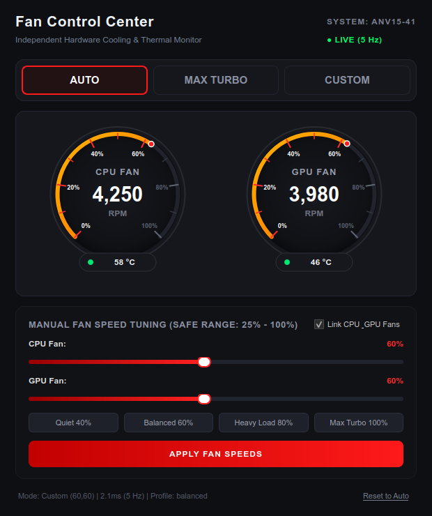

# Fan Control Suite for Linux (`nitrofan`)

A dedicated open-source cooling management suite for modern gaming laptops on Linux.

> **Disclaimer:** Independent community open-source project. Not affiliated with, endorsed by, or associated with Acer Inc. or its subsidiaries. All product names, logos, and brands are property of their respective owners.

Unlike legacy utilities that poke raw bytes into physical Embedded Controller (EC) memory, this project interfaces with standardized ACPI-WMI kernel methods (`linuwu_sense`).

---

## Safety Features

- **Motor Stall Protection**: Custom manual fan speeds are clamped to a safe minimum of 25% to prevent motor stalling and heat buildup.
- **Thermal Safeguard**: Active watchdog elevates fan speeds if CPU or GPU temperatures reach critical thresholds (≥ 88°C) while in custom mode.
- **Zero Invasive Modifications**: No battery charge limit tampering, no keyboard backlight NVRAM poking, no raw physical EC register writes. Strictly 100% cooling and fan control.
- **Fail-Safe Firmware Mode**: Setting fans to Auto (`nitrofan auto`) immediately returns full control to native motherboard BIOS thermal curves.

---

## Features

- **Direct ACPI-WMI Fan Control**: Max Turbo (100%), Automatic (BIOS Managed), and Custom fan speeds.
- **DKMS Kernel Driver**: Pre-configured `linuwu-sense` module automatically rebuilt across Linux kernel updates.
- **Passwordless Control**: Udev rules grant instant write access without entering your `sudo` password.
- **Rich CLI**: Status inspection, real-time live terminal dashboard (`watch`), and quick fan presets.
- **PyQt6 GUI (Fan Control Center)**: Dual circular tachometers, live RPM meters, temperature badges, and interactive sliders.
- **Desktop Entry**: Launches directly from your system application menu.

---

## Quick Start (CLI)

```bash
# Check current fan speeds, active mode, and CPU temperature
nitrofan status

# Force 100% Full Blast Turbo cooling
nitrofan max

# Return to automatic BIOS fan curve
nitrofan auto

# Set custom fan speeds (safe range: 25% - 100%)
nitrofan set 75 65

# Launch real-time live updating terminal dashboard
nitrofan watch

# Launch the Graphical User Interface
nitrofan gui
```

---

## Graphical User Interface (GUI)

Launch the interface via terminal or your desktop app menu:

```bash
nitrofan gui
```

<p align="center">
  
</p>

Features:
- **Real-Time Dual Speedometers**: Dynamic live circular tachometers with clean 10% interval scale marks.
- **Ultra-Fast Telemetry**: High-frequency 5 Hz (200ms) live hardware polling with ~2ms read latency.
- **Responsive 40 FPS Needle Physics**: Smooth needle animations tracking live RPM changes without delay.
- **Hardware Thermal Safeguard**: Automatic elevation to protect silicon if temperatures exceed critical thresholds (≥ 88°C).
- **One-Click Presets**: **Auto**, **Quiet (40%)**, **Balanced (60%)**, **Heavy Load (80%)**, and **Max Turbo (100%)**.
- **Synchronized or Independent Tuning**: Dual interactive sliders with linked or split fan control.
- **System Tray & Side Dock Integration**: Displays custom cooling icon in your application launcher and tray.

---

## Project Structure

```text
Linux-NitroSense/
├── assets/
│   ├── nitrofan.svg         # Generic vector fan icon
│   └── ui_preview.png       # Graphical interface preview screenshot
├── bin/
│   └── nitrofan             # Unified CLI & GUI launcher
├── cli/
│   └── nitro_fan.py         # Command-line telemetry and fan control engine
├── driver/
│   └── linuwu-sense/        # Submodule for ACPI-WMI kernel driver (DKMS)
├── gui/
│   └── nitro_gui.py         # PyQt6 graphical user interface
├── install.sh               # Complete setup script (DKMS, udev rules, desktop launcher)
├── nitrofan.desktop         # Application menu shortcut
├── LICENSE                  # GNU General Public License v3.0
└── README.md
```

---

## Installation & Reinstallation

To reinstall or refresh all components:

```bash
sudo ./install.sh
```

The installer automatically:
1. Registers the kernel module with DKMS.
2. Creates udev permissions for passwordless control.
3. Links the executable to `/usr/local/bin/nitrofan`.
4. Installs the desktop application launcher.

---

## License

This project is licensed under the [GNU General Public License v3.0 (GPL-3.0)](LICENSE).
